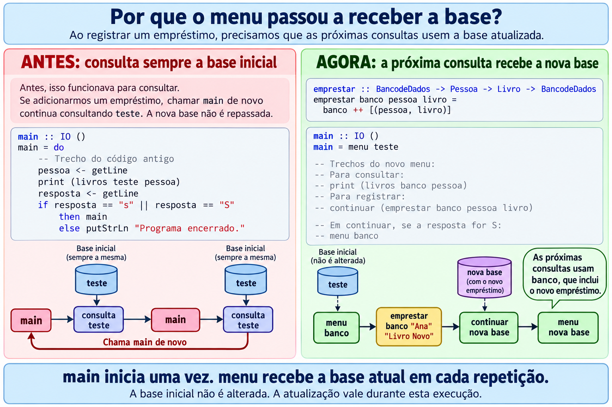

Questão 1 
livros :: BancodeDados -> Pessoa -> [Livro] -- funcao livros que recebe BD e Pessoa e retorna [Livro] Lista
livros banco pessoa =
    -- Verifica a lista vazia antes de usar head ou tail. (null) caso base  //  -[] True 
    if null banco
        then []
        -- fst seleciona a pessoa do primeiro emprestimo e verifica se é igual a pessoa
        else if fst (head banco) == pessoa --   
            --seleciona o segundo elemento da tupla, tranasoforma ela em uma lista com um unico elemento e soma
            --chama recursivamente livros com uma lista dos demais elementos da sequência

            -- Se nao chama recursivamente livros com uma lista dos demais elementos da sequência
            then [snd (head banco)] ++ livros (tail banco) pessoa
            else livros (tail banco) pessoa

Questao 2 IGUAL A QUESTAO 1
pessoas :: BancodeDados -> Livro -> [Pessoa] -- Funcao que recebe banco de dados e pessoa e retorna uma lista
pessoas banco livro =
    if null banco -- verificar se a lista esta vazia se sim retorna vazio
        then []
        else if snd (head banco) == livro -- verificar o segundo elemento da tupla da cabeça da lista 
            -- se for igual retorna o primeiro elemento da tupla e chama pessoas com o restante dos elementos da lista passando livro como argumento
            then [fst (head banco)] ++ pessoas (tail banco) livro
            -- se for diferente retorna chama pessoas com o restante dos elementos da lista passando livro como argumento  
            else pessoas (tail banco) livro

Questao 3

emprestado :: BancodeDados -> Livro -> Bool FUNCAO emprestado que recebe um banco de dados e um livro e retorna um booleano
emprestado banco livro =
    if null banco // se o banco for vazio retorna falso condicao de parada
        then False
        else if snd (head banco) == livro -- Verifica se o segundo elemento da cabeça da lista de tuplas é igual ao livro procurado
            then True
            else emprestado (tail banco) livro 
            -- se nao for chama emprestado recursivamente 

Questao 4

quantidadeLivros :: BancodeDados -> Pessoa -> Int --Passar dois argumentos banco de dados pessoa e retornar um inteiro
quantidadeLivros banco pessoa =
    if null banco -- analisa se a lista esta vazia se estiver retorna 0
        then 0
        else if fst (head banco) == pessoa --analisa o primeiro elemento da cabeca da lista  é igual a pessoa
            then 1 + quantidadeLivros (tail banco) pessoa -- se for retorna 1 mais a funcao chamando o resto da lista e o nome da pessoa
            else quantidadeLivros (tail banco) pessoa -- se nao for retorna a funcao chamando o resto da lista e o nome da pessoa

-- Q5: cria uma nova base com o emprestimo no final.
emprestar :: BancodeDados -> Pessoa -> Livro -> BancodeDados  -- recebe 3 parametros BD,P,L e retorna o BD autualizado 
emprestar banco pessoa livro = banco ++ [(pessoa, livro)]  -- adiciona um novo elemento a lista de tuplas 

continuar :: BancodeDados -> IO ()  (recebe um BD como argumento e retorna uma operação de E/S)
continuar banco = do
    putStrLn "Deseja continuar? (S/N)"  - pergunta pro usuario se ele quer continuar 
    resposta <- getLine
    if resposta == "s" || resposta == "S"   - SE a reposta for sim ele chama de novo a funcao menu passando o BD se nao encerra o programa 
        then menu banco  -- Iniciar uma nova funcao menu com o banco atualizado 
        else putStrLn "Programa encerrado."

menu :: BancodeDados -> IO ()  -- recebe um Bd e retorna uma funcao que e tipo uma operação de E/S
menu banco = do
    putStrLn "1 - Consultar livros por pessoa"
    putStrLn "2 - Consultar pessoas por livro"
    putStrLn "3 - Verificar se um livro esta emprestado"
    putStrLn "4 - Consultar quantidade de livros por pessoa"
    putStrLn "5 - Registrar emprestimo"
    putStrLn "0 - Sair"
    opcao <- getLine

PQ USAR MENU AO INVES DE USAR CRIAR O MENU NA MAIN
Se ela chamasse a si mesma após cadastrar um empréstimo, voltaria à base inicial e perderia a atualização.

A funcao main nao tem   main :: IO () um segundo argumento para passar o BD atualizado 
Menu tem  menu :: BancodeDados -> IO ()

QUESTÂO 6 --recebe um banco de dados pessoa e livro e retorna um BD atualizado 
devolver :: BancodeDados -> Pessoa -> Livro -> BancodeDados (recebe 3 argumentos e retorna o BD)
devolver banco pessoa livro =
    if null banco--  banco nulo retorna nada 
        then []
        else if head banco == (pessoa, livro) -- compara a tupla da cabeça da livra e a tupla que foi recebida
            then tail banco  --  S retorne somente o resto da lista 
            else [head banco] ++ devolver (tail banco) pessoa livro   --devolve o primeiro elemento da llista mais a funcao com o resto da livro a pessoa e o livro 

Q7
quantidadeLivros :: BancodeDados -> Pessoa -> Int
quantidadeLivros banco pessoa =
    if null banco -- banco nulo 0
        then 0
        else if fst (fst (head banco)) == pessoa  -- Veifica o primeiro elemento da cabeça e o primeiro elemento que esta na cabeça e compara com a pessoa 
            then 1 + quantidadeLivros (tail banco) pessoa Se sim Retorna 1 + chama a funcao para o resto da lista 
            else quantidadeLivros (tail banco) pessoa

existeLivro :: Catalogo -> Livro -> Bool
existeLivro acervo livro =
    if null acervo
        then False
        else if fst (head acervo) == livro
            then True
            else existeLivro (tail acervo) livro

emprestar :: BancodeDados -> Pessoa -> Livro -> Data -> Data -> BancodeDados -- 4 parametros e reotnra um novo BD 
emprestar banco pessoa livro retirada prazo =
    if quantidadeLivros banco pessoa >= limiteLivros -- se ultrapassar retorna o banco igual se nao
        then banco
        else if existeLivro catalogo livro -- verifica se o livro existe
            then if retirada > 0 && prazo >= retirada -- 
                then banco ++ [((pessoa, livro), (retirada, prazo))]
                else banco
            else banco

Q8

temPalavra :: [PalavraChave] -> PalavraChave -> Bool -- recebe uma lista de palavras e percorre essa lista e vai fericiando se a PAlavraChave Esta dentro da lista 
temPalavra palavras palavra =
    if null palavras
        then False
        else if head palavras == palavra  
            then True Se sim retorna true 
            else temPalavra (tail palavras) palavra retorna Falso 

livrosPorPalavra :: Catalogo -> PalavraChave -> [Livro]
livrosPorPalavra acervo palavra =
    if null acervo -- acervo for nul condição de palavra
        then []
        else if temPalavra (snd (head acervo)) palavra  -- pega a lista de palavras associadas a cabeça da lista do acervo. e aplica a funcao tem palavra
            -- se sim eu quero o primeiro elemento da cabeça do acervo e soma com a funcao livros por palavra chamando recursivamente o resto das livras
            then [fst (head acervo)] ++ livrosPorPalavra (tail acervo) palavra
            else livrosPorPalavra (tail acervo) palavra

Glossário e Resumo 

--Lista 
--sta é uma estrutura de dados formada por uma sequência de valores (elementos) do mesmo tipo.
--Os elementos de uma lista são identificados pela posição em que ocorrem na lista.
--lista vazia []
--head o primeiro elemento da sequência
--tail uma lista dos demais elementos da sequência
--head: retorna o primeiro elemento de uma lista.

--tupla tem ("Pedro",19)
--fst: seleciona o primeiro componente da tupla:PEdro
--snd: seleciona o segundo componente de um par:19